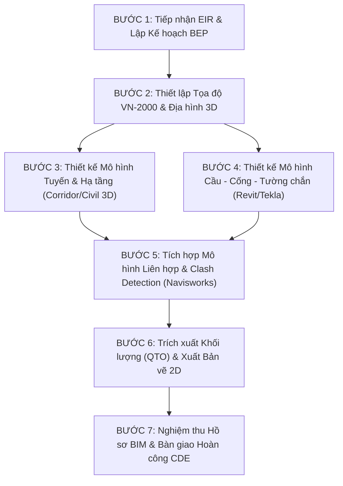

# QUY TRÌNH ỨNG DỤNG MÔ HÌNH THÔNG TIN CÔNG TRÌNH (BIM)
## CHO DỰ ÁN CÔNG TRÌNH GIAO THÔNG VÀ HẠ TẦNG KỸ THUẬT

---

> **CĂN CỨ PHÁP LÝ & TIÊU CHUẨN KỸ THUẬT ÁP DỤNG:**
> - **Luật Xây dựng số 135/2025/QH15** & **Luật Đường bộ số 35/2024/QH15**.
> - **Quyết định số 258/QĐ-TTg** ngày 17/03/2023 của Thủ tướng Chính phủ: Phê duyệt Lộ trình áp dụng Mô hình thông tin công trình (BIM) trong hoạt động xây dựng (Bắt buộc từ năm 2023 đối với công trình cấp I, đặc biệt; từ năm 2025 đối với công trình cấp II sử dụng vốn đầu tư công, PPP).
> - **Quyết định số 348/QĐ-BXD** ngày 02/04/2021 của Bộ Xây dựng: Hướng dẫn chung áp dụng Mô hình thông tin công trình (BIM).
> - **Quyết định số 347/QĐ-BXD** ngày 02/04/2021 của Bộ Xây dựng: Hướng dẫn áp dụng BIM cho công trình Dân dụng và Hạ tầng kỹ thuật đô thị.
> - **TCVN 14177:2024 (ISO 19650-1 & ISO 19650-2)**: Quản lý thông tin bằng BIM.
> - **Nghị định 207/2026/NĐ-CP** & **Thông tư 32/2026/TT-BXD**: Quản lý chất lượng, thi công và bảo trì công trình xây dựng.

---

### PHẦN I. HỆ THỐNG MỤC TIÊU VÀ NGUYÊN TẮC ÁP DỤNG BIM

#### 1. Mục tiêu ứng dụng BIM trong dự án Cầu - Đường - Hạ tầng kỹ thuật
1. **Trực quan hóa thiết kế đa chiều (3D Visualization):** Mô hình hóa địa hình hiện trạng, hướng tuyến tuyến đường, cầu vượt sông, nút giao lập thể, hầm chui và toàn bộ công trình ngầm hạ tầng.
2. **Kiểm soát và giải quyết xung đột không gian (Clash Detection):** Phát hiện 100% va chạm cứng giữa kết cấu móng cọc, đài mố trụ với các công trình ngầm kỹ thuật hiện hữu (ống cấp thoát nước, cáp điện ngầm, hào kỹ thuật tuynel) trước khi ra công trường.
3. **Tự động hóa bóc tách khối lượng (QTO - Quantity Takeoff):** Trích xuất khối lượng đào đắp nền đường, khối lượng bê tông, cốt thép, bê tông nhựa, cấp phối đá dăm đồng bộ với dự toán chi phí theo Thông tư 38/2026/TT-BXD.
4. **Mô phỏng tiến độ thi công (BIM 4D):** Phân chia giai đoạn phân luồng giao thông, lao lắp dầm cầu, đổ bê tông bản mặt cầu, thi công móng mố trụ trong mùa cạn.
5. **Cơ sở dữ liệu hoàn công số (As-Built & Digital Twin):** Phục vụ quản lý tài sản kết cấu hạ tầng giao thông đường bộ theo vòng đời dự án.

---

### PHẦN II. QUY ĐỊNH VỀ MÔI TRƯỜNG DỮ LIỆU CHUNG (CDE)

Mọi trao đổi dữ liệu, tài liệu, bản vẽ và mô hình BIM phải được lưu trữ tập trung trên Môi trường dữ liệu chung CDE (sử dụng nền tảng Autodesk Construction Cloud / BIM 360, Trimble Connect, hoặc hệ thống Cloud Server nội bộ của Dự án) và phân chia nghiêm ngặt thành 4 thư mục:

```
├── 01_WIP (Work In Progress)
│   ├── RD_DuongBo
│   ├── BR_CauCong
│   ├── DR_ThoatNuoc
│   └── GE_KhaoSatDiaChat
├── 02_SHARED (Du lieu da kiem duyet noi bo de phoi hop lien nganh)
│   ├── BoMon_DuongBo_ChuyenGiao
│   ├── BoMon_CauCong_ChuyenGiao
│   └── MoHinh_LienHop_Federated_Model
├── 03_PUBLISHED (Ho so xuat ban duyet tham tra / BVTC / Thi cong)
│   ├── BanVe_2D_PDF_KySo
│   ├── MoHinh_IFC_ChuanHoa
│   └── BangKhoiLuong_DuToan_5D
└── 04_ARCHIVED (Luu tru hoan cong As-Built va Lich su phien ban)
```

---

### PHẦN III. QUY TRÌNH 7 BƯỚC TRIỂN KHAI THIẾT KẾ VÀ QUẢN LÝ DỰ ÁN BIM



#### Bước 1. Tiếp nhận EIR và Ban hành Kế hoạch thực hiện BIM (BEP)
- Tiếp nhận tài liệu **Yêu cầu thông tin trao đổi (EIR)** từ Chủ đầu tư / Ban QLDA.
- Đơn vị Tư vấn trưởng phối hợp các thầu phụ lập **Kế hoạch thực hiện BIM (BEP)** theo mẫu chuẩn hóa tại `Mau_KeHoachThucHien_BIM_BEP_CauDuong.docx`.
- Xác định rõ: Ma trận trách nhiệm (RACI), mức độ phát triển mô hình (LOD 100 - LOD 400), danh mục phần mềm tác tử và định dạng trao đổi (.RVT, .DWG, .IFC).

#### Bước 2. Thiết lập Hệ tọa độ chuẩn Quốc gia VN-2000 và Bề mặt địa hình số 3D
- Thiết lập Kinh tuyến trục địa phương và múi chiếu 3 độ hoặc 6 độ của tỉnh/thành phố nơi xây dựng công trình (tham chiếu bảng tra cứu tại `02_SoLieuDauVao_DungChung`).
- Dựng mô hình Bề mặt địa hình số (TIN Surface / DEM) từ dữ liệu khảo sát bay chụp LiDAR hoặc trắc địa toàn đạc điện tử.

#### Bước 3. Thiết kế mô hình Tuyến đường và Hạ tầng kỹ thuật (Autodesk Civil 3D / OpenRoads)
- Vạch tim tuyến (Alignment), thiết kế đường đỏ trắc dọc (Profile) và mặt cắt ngang điển hình (Subassembly Composer).
- Xây dựng mô hình bình đồ không gian tuyến đường (Corridor Model), vuốt siêu cao, mở rộng bán kính đường cong nằm theo QCVN 117:2024/BGTVT hoặc TCVN 4054:2005.
- Thiết kế hệ thống rãnh biên, cống tròn, cống hộp, cống kỹ thuật ngầm và hoàn thiện mái taluy nền đào, nền đắp.

#### Bước 4. Thiết kế mô hình Kết cấu Cầu - Cống - Hầm chui (Autodesk Revit / Tekla Structures)
- Xây dựng mô hình móng cọc khoan nhồi / cọc đóng, bệ mố trụ, thân mố trụ cầu.
- Mô hình hóa kết cấu nhịp cầu: dầm Super-T, dầm I bê tông cốt thép dự ứng lực, dầm hộp đúc hẫng cân bằng hoặc dàn thép.
- Mô hình hóa chi tiết bản mặt cầu, lan can, dải phân cách, gối cầu, khe co giãn, tường chắn có cốt (MSE) hoặc tường trọng lực rọ đá (TCCS 13:2016).

#### Bước 5. Tích hợp Mô hình liên hợp và Kiểm soát xung đột (Navisworks Manage)
- Ghép nối toàn bộ các mô hình bộ môn thành **Federated Model** trên Navisworks Manage hoặc Solibri.
- Thiết lập bộ quy tắc kiểm tra va chạm (Clash Rules):
  - *Hard Clash (Khoảng cách dung sai 0 mm):* Va chạm kết cấu cọc móng cầu với công trình ngầm; cốt thép chủ giao cắt ống bọc cáp dự ứng lực.
  - *Clearance Clash (Khoảng cách tĩnh không an toàn):* Tĩnh không gầm cầu vượt đường bộ (tối thiểu 4.75 m theo QCVN 117:2024) và tĩnh không thông thuyền vượt sông (theo cấp sông TCVN 5664:2009).
- Xuất Báo cáo va chạm định dạng BCF, giao ban xử lý dứt điểm các điểm giao cắt.

#### Bước 6. Trích xuất khối lượng tự động (QTO) và Phát hành bản vẽ 2D
- Bóc tách khối lượng tự động trực tiếp từ mô hình hình học: thể tích bê tông mố trụ, dầm, khối lượng cốt thép (kg), diện tích mặt đường bê tông nhựa ($m^2$), khối lượng đào đất đắp đá ($m^3$).
- Thiết lập liên kết động (Live Link) giữa mô hình 3D và bản vẽ 2D: khi điều chỉnh kích thước hoặc hình học trên 3D, bản vẽ trắc dọc, trắc ngang và mặt cắt kết cấu 2D tự động cập nhật, triệt tiêu sai số giữa bản vẽ và bảng dự toán.

#### Bước 7. Nghiệm thu hồ sơ BIM và Chuyển giao hoàn công CDE
- Kiểm tra tính tuân thủ tiêu chuẩn kỹ thuật và tính đầy đủ của thuộc tính đối tượng (LOI).
- Xuất file chuẩn mở quốc tế **IFC (IFC 4.3 cho Infrastructure)** đảm bảo tính mở và khả năng lưu trữ độc lập với phiên bản phần mềm.
- Đóng gói hồ sơ số bàn giao Chủ đầu tư và chuyển vào phân vùng `04_ARCHIVED` trên hệ thống CDE.

---

### PHẦN IV. DANH MỤC BIỂU MẪU VÀ TÀI LIỆU BIM LIÊN KẾT

1. [QD_258_2023_QD_TTg_LoTrinhApDungBIM_ChinhPhu.pdf](file:///F:/OneDrive/DTXM_GROUP/01_VBPL_TieuChuan_DinhMuc/08_BIM_TieuChuan_HuongDan_QuyTrinh/QD_258_2023_QD_TTg_LoTrinhApDungBIM_ChinhPhu.pdf) - Lộ trình áp dụng BIM toàn quốc.
2. [QD_348_2021_BXD_HuongDanChungApDungBIM.pdf](file:///F:/OneDrive/DTXM_GROUP/01_VBPL_TieuChuan_DinhMuc/08_BIM_TieuChuan_HuongDan_QuyTrinh/QD_348_2021_BXD_HuongDanChungApDungBIM.pdf) - Hướng dẫn chung áp dụng BIM của Bộ Xây dựng.
3. [QD_347_2021_BXD_HuongDanBIM_HaTangKyThuat_DanDung.pdf](file:///F:/OneDrive/DTXM_GROUP/01_VBPL_TieuChuan_DinhMuc/08_BIM_TieuChuan_HuongDan_QuyTrinh/QD_347_2021_BXD_HuongDanBIM_HaTangKyThuat_DanDung.pdf) - Hướng dẫn chi tiết BIM hạ tầng kỹ thuật.
4. [TCVN_14177_BIM_ISO19650_HuongDanQuanLyThongTin.pdf](file:///F:/OneDrive/DTXM_GROUP/01_VBPL_TieuChuan_DinhMuc/08_BIM_TieuChuan_HuongDan_QuyTrinh/TCVN_14177_BIM_ISO19650_HuongDanQuanLyThongTin.pdf) - Tiêu chuẩn ISO 19650 quản lý thông tin BIM.
5. [Mau_KeHoachThucHien_BIM_BEP_CauDuong.docx](file:///F:/OneDrive/DTXM_GROUP/01_VBPL_TieuChuan_DinhMuc/08_BIM_TieuChuan_HuongDan_QuyTrinh/Mau_KeHoachThucHien_BIM_BEP_CauDuong.docx) - Mẫu Kế hoạch BEP áp dụng cho dự án Cầu Đường.
