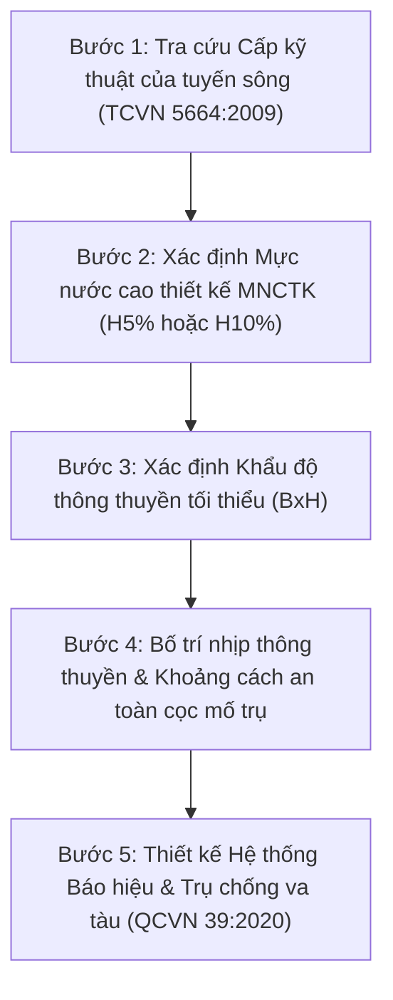

# QUY TRÌNH THIẾT KẾ CÔNG TRÌNH THỦY, ĐƯỜNG THỦY NỘI ĐỊA VÀ CẢNG BIỂN
## CẨM NANG TRA CỨU TIÊU CHUẨN, TÍNH TOÁN TĨNH KHÔNG THÔNG THUYỀN VÀ THIẾT KẾ KẾT CẤU THỦY CÔNG

---

> **CĂN CỨ PHÁP LÝ & QUY CHUẨN, TIÊU CHUẨN KỸ THUẬT HIỆN HÀNH:**
> - **Luật Giao thông Đường thủy nội địa** & **Bộ luật Hàng hải Việt Nam**.
> - **Luật Xây dựng số 135/2025/QH15** & **Luật Đường bộ số 35/2024/QH15**.
> - **QCVN 39:2020/BGTVT**: Quy chuẩn kỹ thuật quốc gia về Báo hiệu đường thủy nội địa Việt Nam.
> - **TCVN 5664:2009**: Phân cấp kỹ thuật đường thủy nội địa (Kích thước khoang thông thuyền cầu).
> - **TCVN 11820:2017**: Công trình bến cảng biển - Yêu cầu thiết kế.
> - **QCVN 04-05:2022/BNNPTNT**: Quy chuẩn kỹ thuật quốc gia về công trình thủy lợi - Các quy định chủ yếu về thiết kế.
> - **TCVN 9901:2023** & **TCVN 9902:2023**: Yêu cầu thiết kế Đê biển & Đê sông.
> - **TCVN 9152:2012**: Quy trình thiết kế tường chắn công trình thủy lợi.
> - **TCVN 12260:2018**: Công trình chỉnh trị đường thủy nội địa (Kè bạt mái, mỏ hàn nắn dòng).
> - **TCVN 10379:2014**: Gia cố mái dốc bằng giải pháp neo trong xây dựng công trình thủy.

---

### PHẦN I. HỆ THỐNG PHÂN CẤP SÔNG VÀ XÁC ĐỊNH TĨNH KHÔNG THÔNG THUYỀN CẦU QUA SÔNG

Khi thiết kế cầu vượt sông hoặc công trình giao cắt qua luồng đường thủy nội địa, việc xác định khẩu độ thông thuyền (Bề rộng B và Chiều cao tĩnh không H) là điều kiện tiên quyết bắt buộc phải thỏa hiệp với Cơ quan quản lý đường thủy nội địa (Cục ĐTNĐ Việt Nam hoặc Sở GTVT địa phương).

#### Bảng tra cứu Tĩnh không thông thuyền chuẩn Quốc gia (TCVN 5664:2009)

| Cấp sông | Tàu / Đoàn tàu thiết kế | Bề rộng khoang 2 chiều B (m) | Bề rộng 1 chiều B (m) | Chiều cao tĩnh không H (m) | Tần suất MNCTK |
| :--- | :--- | :---: | :---: | :---: | :---: |
| **Cấp Đặc biệt** | Tàu biển $\ge 3.000$ DWT | $\ge 100 \div 150$ m | $\ge 80$ m | $\ge 25.0 \div 39.0$ m | $P = 5\%$ |
| **Cấp I** | Đoàn lai 4 x 400T / Tàu $1.000 \div 2.000$T | $\ge 80$ m | $\ge 50$ m | $\ge 10.0$ m (sông hồ 11 m) | $P = 5\%$ |
| **Cấp II** | Đoàn đẩy 4 x 400T / Tàu $500 \div 1.000$T | $\ge 60$ m | $\ge 40$ m | $\ge 9.0$ m (sông hồ 9.5 m) | $P = 5\%$ |
| **Cấp III** | Đoàn lai 2 x 400T / Tàu $300 \div 500$T | $\ge 50$ m | $\ge 30$ m | $\ge 7.0$ m (sông hồ 7.5 m) | $P = 5\%$ |
| **Cấp IV** | Tàu tự hành $100 \div 300$T | $\ge 40$ m | $\ge 25$ m | $\ge 6.0$ m | $P = 10\%$ |
| **Cấp V** | Tàu tự hành $50 \div 100$T | $\ge 30$ m | $\ge 20$ m | $\ge 3.5 \div 4.0$ m | $P = 10\%$ |
| **Cấp VI** | Phương tiện thủy nhỏ $10 \div 50$T | $\ge 20$ m | $\ge 15$ m | $\ge 2.5 \div 3.0$ m | $P = 10\%$ |

> **LƯU Ý THỰC CHIẾN:**
> - Chiều cao tĩnh không $H$ được đo từ điểm thấp nhất của đáy dầm cầu trong phạm vi khoang thông thuyền tới **Mực nước cao thiết kế (MNCTK)**.
> - Đáy bệ mố trụ cầu nằm trong phạm vi lòng sông phải được chôn sâu dưới chiều sâu xói lở dự báo lớn nhất (xói chung lòng dẫn + xói cục bộ quanh trụ cầu do dòng chảy mùa lũ).

---

### PHẦN II. NGUYÊN TẮC THIẾT KẾ CÔNG TRÌNH BẾN CẢNG BIỂN (TCVN 11820:2017)

#### 1. Lựa chọn dạng kết cấu bến phù hợp với điều kiện địa chất - thủy hải văn
1. **Bến bệ cọc đài cao (High Piled Wharf):**
   - Áp dụng khi địa chất có tầng bùn sét yếu dày, tầng chịu lực nằm sâu bên dưới.
   - Kết cấu móng gồm cọc ống thép hàn ($\phi 800 \div 1.400$ mm) hoặc cọc bê tông ly tâm ứng suất trước (PHC/Nodular Pile), cọc xiên chống lực xô ngang do tàu cập bến.
2. **Bến tường cừ thép neo (Anchored Sheet Pile Wall):**
   - Áp dụng cho các bến liền bờ nước nông và trung bình (tàu đến 20.000 DWT).
   - Tường cừ thép Larsen IV, Larssen V hoặc hệ cừ kết hợp (Combi-wall: Cọc ống thép + Cừ phẳng) được neo vào bản neo hoặc hệ cọc nghiêng bằng thanh neo thép hợp kim cường độ cao.
3. **Bến khối trọng lực & Thùng chìm (Gravity & Caisson Quay Wall):**
   - Áp dụng khi địa chất đáy biển là đá nông hoặc cát cuội sỏi chặt.

#### 2. Tính toán năng lượng va đập tàu khi cập bến và chọn đệm va
Năng lượng va đập thiết kế của tàu truyền vào hệ đệm va:
$$E_{ship} = \frac{1}{2} M_v \cdot V_n^2 \cdot C_e \cdot C_m \cdot C_s \cdot C_c$$
- $M_v$: Khối lượng giãn nước thực tế của tàu thiết kế (tấn).
- $V_n$: Thành phần vận tốc cập bến vuông góc với mặt mép bến ($V_n = 0.10 \div 0.25$ m/s).
- $C_e$: Hệ số lệch tâm do điểm va chạm không trùng trọng tâm tàu.
- $C_m$: Hệ số khối lượng nước kèm ($C_m = 1 + \frac{2 D_{draft}}{B_{ship}}$).
- $C_s$: Hệ số mềm của vỏ tàu ($C_s \approx 0.90 \div 0.95$).

---

### PHẦN III. THIẾT KẾ ĐÊ, KÈ BẢO VỆ BỜ VÀ CHỈNH TRỊ SÔNG (TCVN 9901, 9902, 12260)

#### 1. Các giải pháp gia cố bảo vệ mái taluy bờ sông, đê kè chống xói lở
1. **Thảm đá bọc rọ thép mạ kẽm bọc nhựa PVC (TCCS 13:2016 & TCVN 10335):**
   - Kích thước thảm đá thông dụng: $(2 \times 3 \times 0.23)$ m hoặc $(2 \times 4 \times 0.3)$ m.
   - Thích ứng tốt với biến dạng lún không đều của nền đất bờ sông, thoát nước ngầm tự nhiên không tích tụ áp lực nước lỗ rỗng.
2. **Tấm bê tông đúc sẵn tự chèn có lỗ trồng cỏ (TCVN 9902:2023):**
   - Áp dụng cho phần bờ sông nằm phía trên mực nước kiệt thiết kế.
   - Thân thiện với môi trường, tăng cường cảnh quan sinh thái ven đô thị.
3. **Chân khay giữ chân kè (Toe Protection):**
   - Lăng thăng đá hộc thả rối hình thang dưới chân kè chống xói chân do dòng chảy xiết và sóng tàu thủy tạo ra.

#### 2. Nguyên tắc bố trí Đê mỏ hàn nắn dòng (TCVN 12260:2018)
- Chiều dài mỏ hàn $L_{mh} \le 0.15 \div 0.20$ bề rộng lòng sông để tránh gây thu hẹp lòng dẫn quá mức gây xói lở bờ đối diện.
- Khoảng cách giữa các mỏ hàn liền kề: $S = (2.0 \div 3.0) \times L_{mh}$.
- Mỏ hàn chúc xuôi giúp đưa dòng chủ lưu ra xa bờ êm thuận, giảm thiểu tạo xoáy sau đầu mỏ hàn.

---

### PHẦN IV. DANH MỤC TÀI LIỆU VÀ TIÊU CHUẨN LIÊN KẾT TRONG THƯ MỤC 09

1. [QCVN_39_2020_BGTVT_BaoHieuDuongThuyNoiDia.pdf](file:///F:/OneDrive/DTXM_GROUP/01_VBPL_TieuChuan_DinhMuc/09_CongTrinhThuy_DuongThuy_CangBien/QCVN_39_2020_BGTVT_BaoHieuDuongThuyNoiDia.pdf) - Bản ký số chính thức Bộ GTVT.
2. [TCVN_5664_2009_PhanCapKyThuatDuongThuyNoiDia.pdf](file:///F:/OneDrive/DTXM_GROUP/01_VBPL_TieuChuan_DinhMuc/09_CongTrinhThuy_DuongThuy_CangBien/TCVN_5664_2009_PhanCapKyThuatDuongThuyNoiDia.pdf) - Phân cấp kỹ thuật đường thủy & tĩnh không cầu.
3. [TCVN_11820_2017_CongTrinhBenCangBien_YeuCauThietKe.pdf](file:///F:/OneDrive/DTXM_GROUP/01_VBPL_TieuChuan_DinhMuc/09_CongTrinhThuy_DuongThuy_CangBien/TCVN_11820_2017_CongTrinhBenCangBien_YeuCauThietKe.pdf) - Thiết kế công trình bến cảng biển.
4. [QCVN_04_05_2022_BNNPTNT_CongTrinhThuyLoi_CacQuyDinhThietKe.pdf](file:///F:/OneDrive/DTXM_GROUP/01_VBPL_TieuChuan_DinhMuc/09_CongTrinhThuy_DuongThuy_CangBien/QCVN_04_05_2022_BNNPTNT_CongTrinhThuyLoi_CacQuyDinhThietKe.pdf) - Quy chuẩn thiết kế công trình thủy lợi.
5. [TCVN_9901_2023_CongTrinhThuyLoi_YeuCauThietKeDeBien.pdf](file:///F:/OneDrive/DTXM_GROUP/01_VBPL_TieuChuan_DinhMuc/09_CongTrinhThuy_DuongThuy_CangBien/TCVN_9901_2023_CongTrinhThuyLoi_YeuCauThietKeDeBien.pdf) - Thiết kế đê biển mới nhất.
6. [TCVN_9902_2023_CongTrinhThuyLoi_YeuCauThietKeDeSong.pdf](file:///F:/OneDrive/DTXM_GROUP/01_VBPL_TieuChuan_DinhMuc/09_CongTrinhThuy_DuongThuy_CangBien/TCVN_9902_2023_CongTrinhThuyLoi_YeuCauThietKeDeSong.pdf) - Thiết kế đê sông mới nhất.
7. [TCVN_9152_2012_QuyTrinhThietKeTuongChanCongTrinhThuyLoi.pdf](file:///F:/OneDrive/DTXM_GROUP/01_VBPL_TieuChuan_DinhMuc/09_CongTrinhThuy_DuongThuy_CangBien/TCVN_9152_2012_QuyTrinhThietKeTuongChanCongTrinhThuyLoi.pdf) - Thiết kế tường chắn đất thủy lợi.
8. [TCVN_12260_2018_CongTrinhChinhTriDuongThuyNoiDia.pdf](file:///F:/OneDrive/DTXM_GROUP/01_VBPL_TieuChuan_DinhMuc/09_CongTrinhThuy_DuongThuy_CangBien/TCVN_12260_2018_CongTrinhChinhTriDuongThuyNoiDia.pdf) - Chỉnh trị luồng tàu và kè mỏ hàn.
9. [TCVN_10379_2014_GiaCoMaiDoc_GiaiPhapNeo_CongTrinhThuy.pdf](file:///F:/OneDrive/DTXM_GROUP/01_VBPL_TieuChuan_DinhMuc/09_CongTrinhThuy_DuongThuy_CangBien/TCVN_10379_2014_GiaCoMaiDoc_GiaiPhapNeo_CongTrinhThuy.pdf) - Gia cố mái dốc bằng neo.
